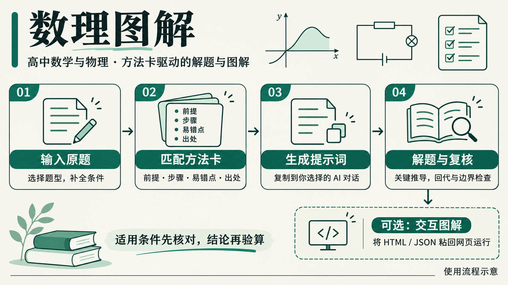

# mp_skills · 数理图解

面向高中数学和物理的学习工具：用教材方法卡约束解题过程，为不同 AI 生成提示词，需要时再制作交互图解。覆盖有图和无图的知识点，强调适用条件、关键推导和实际验算。教师和开发者也可以安装 `solver-lab`，在本地调用计算内核生成题解和课件。

[打开数理图解](https://solver-lab-mobile-20261106-8082.wwk58317.chatgpt.site) · [网页提示词导航](solver-lab/prompts/README.md) · [必刷题方法卡索引](docs/study/bishua-2027-index.md) · [Agent 安装与使用](solver-lab/references/agent-workflow.md)



*使用流程示意，非网站截图。网页负责组合提示词和预览课件；解题在你选择的 AI 对话中完成。*

## 选一个入口

| 你想做什么 | 从哪里开始 |
| --- | --- |
| 用手机试一份课件，或把自己的题变成图解 | [手机快速上手](#手机快速上手) |
| 在 DeepSeek、千问、豆包或 ChatGPT 里逐步解题 | [在聊天网页中使用提示词](#在聊天网页中使用提示词) |
| 安装技能，在本地生成题解、核验数值或导出课件 | [安装 solver-lab](#安装-solver-lab) |
| 按题型或章节查教材解法 | [查找教材方法](#查找教材方法) |

## 手机快速上手

1. 用手机浏览器打开[数理图解](https://solver-lab-mobile-20261106-8082.wwk58317.chatgpt.site)。想先试效果，在「运行代码」里选「运动」「电路」或「截面」，再点「运行图解」。
2. 要做自己的题，切到「生成提示词」，选题型和 AI，粘贴原题。题型切换会更新试用题和参考专题，输入题目后显示实际推荐。也可展开「手选教材专题」选择。只要文字讲解就选「分步解题」；需要图形或动画就选「解题与交互图解」。
3. 把生成的提示词复制到所选 AI 的对话，题图可以一并发送。拿到完整 HTML 或模板 JSON 后，回到「运行代码」粘贴并运行。若回复有多个代码块，只复制要打开的那一份。
4. 图解白屏、播放异常或排版拥挤时，使用「图解有问题」复制修复提示，再发回原对话。也可以附上现有代码和问题截图。[布局修复提示词](solver-lab/prompts/web-layout-repair.md)

公开站无需 ChatGPT 登录。普通访客每天 20 次，生成提示词和运行图解共用额度，北京时间零点重置。兑换邀请码可解锁当前浏览器的限额。题目和课件都在浏览器内处理，草稿与最近三条运行记录保存在本机。[手机使用说明](mobile-preview/README.md)

## 在聊天网页中使用提示词

选一个主提示词，按需附相关题型和当前平台的补充词，最后附完整题目与题图。

| 目标 | 主提示词 | 返回内容 |
| --- | --- | --- |
| 读懂思路、推导与易错点 | [分步解题](solver-lab/prompts/web-study.md) | 文字题解、公式和复核 |
| 复用固定课件 | [通用课件](solver-lab/prompts/web-common.md) | 与模板匹配的 LessonSpec JSON |
| 演示综合题、作图过程或动态关系 | [复杂题图解](solver-lab/prompts/web-advanced.md) | 完整的单文件 HTML |

平台补充词按当前对话选择。[ChatGPT](solver-lab/prompts/chatgpt.md) · [DeepSeek](solver-lab/prompts/deepseek.md) · [豆包](solver-lab/prompts/doubao.md) · [千问 / Qwen](solver-lab/prompts/qwen.md) · [按题型选择补充词](solver-lab/prompts/subjects/)

LessonSpec 模板覆盖**一维恒加速度运动、理想串联电路、受支持的标准实体截面**。请按题设匹配模板，并在首次使用时附对应的完整 HTML。超出模板范围的题，交付样式、脚本和图形均内联的单文件 HTML，可下载后离线打开，也可粘贴到手机预览器。[运动模板](solver-lab/examples/lesson-motion.html) · [电路模板](solver-lab/examples/lesson-circuit.html) · [截面模板](solver-lab/examples/lesson-section.html)

## 安装 solver-lab

技能需要 **Node.js 18 或更新版本**，基础求解使用 Node.js 内置模块，可离线运行。先克隆仓库并运行一个匀变速示例：

```sh
git clone https://github.com/someone8082/mp_skills.git
cd mp_skills
node solver-lab/scripts/agent.mjs --doctor
node solver-lab/scripts/agent.mjs solver-lab/lesson/examples/motion.json --out ./motion-result --html
```

在 `motion-result/` 查看 `solution.md` 题解、`report.json` 检查报告和 `lesson.html` 交互课件。再次运行时为 `--out` 指定一个尚不存在的目录。想查看支持的输入和任务，运行 `node solver-lab/scripts/agent.mjs --capabilities`。

在 Agent 中使用时，把整个 `solver-lab/` 复制到宿主识别的技能目录。例如项目级 Codex 可放到 `.agents/skills/solver-lab/`。进入项目后给 Agent 完整题目，并说明需要文字推导、数值核验还是图解。[技能入口](solver-lab/SKILL.md) · [安装和调用说明](solver-lab/references/agent-workflow.md)

## 查找教材方法

知识库收录 2027 版《高考必刷题·数学合订本》的 132 张方法卡，覆盖 12 章，也收录原数学讲义和力学专题。方法卡整理了适用条件、推导步骤、易错点及资料页码，便于按题选法和回到原资料核对。

在仓库根目录按关键词查询，例如：

```sh
node solver-lab/scripts/study.mjs --query "列联表独立性检验" --collection bishua-2027
```

网页按题目自动推荐至多两张卡，也可手选教材专题。题型参考与题目匹配分开显示：没有匹配时，参考卡不会自动附入提示词，手选仍可使用。构建时将方法卡嵌入页面，目录和推荐无需另行下载卡片文件。

提示词要求 AI 逐项核对卡片前提，在实际使用处注明方法依据，把相关易错点转成检查，并给出回代、边界或另一条关系的验算结果。方法卡和自测帮助发现错误，不能代替对原题和证明的判断。[必刷题逐章索引](docs/study/bishua-2027-index.md) · [离线方法检索](solver-lab/references/study-guide.md) · [18 份物理专题课件提示词](solver-lab/prompts/physics-courseware.md)

## 需要图解时，试一个完整示例

| 示例 | 用来观察什么 |
| --- | --- |
| [一维运动](solver-lab/examples/lesson-motion.html) | 位置、速度与时间的对应关系 |
| [理想串联电路](solver-lab/examples/lesson-circuit.html) | 电流、电压和电阻之间的关系 |
| [截面作图](docs/demos/section-construction.html) | 从已知点找到辅助点，再逐步闭合截面 |

在 GitHub 文件页通过下载或 Raw 保存 HTML，再用浏览器打开。也可以把完整 HTML 粘贴到网站的「运行代码」。

## 使用边界与开发资料

- 计算内核校验受支持模型中的数值和关系。题意、模型假设与文字证明仍需结合原题核对。[综合题与证明核验](solver-lab/references/advanced-problems.md)
- 手机预览器在隔离框内执行课件。制作课件时把脚本、样式和资源随 HTML 一起交付。聊天网页能否直接执行 JavaScript 取决于实际环境。[网页预览兼容记录](solver-lab/docs/browser-compatibility.md)
- 想修改或自行搭建站点，从 `mobile-preview/` 开始，开发运行需要 Node.js 22 或更新版本。搭建约束涵盖页面联动、方法卡、模型提示词、额度和发布验收。[网站搭建约束](mobile-preview/BUILD_CONSTRAINTS.md) · [预览器开发指南](mobile-preview/README.md#本地开发) · [仓库目录导航](docs/README.md) · [历史验证记录](docs/validation/)
