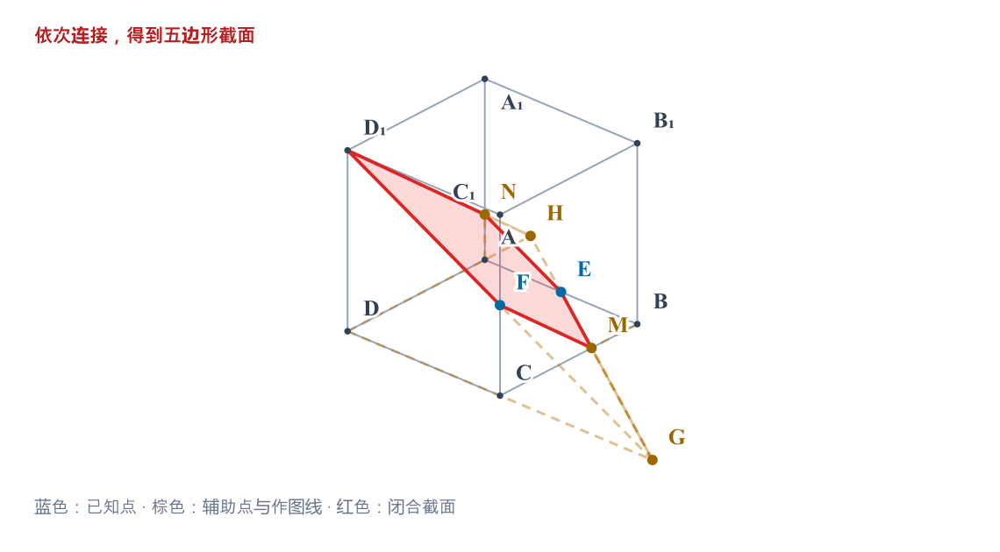
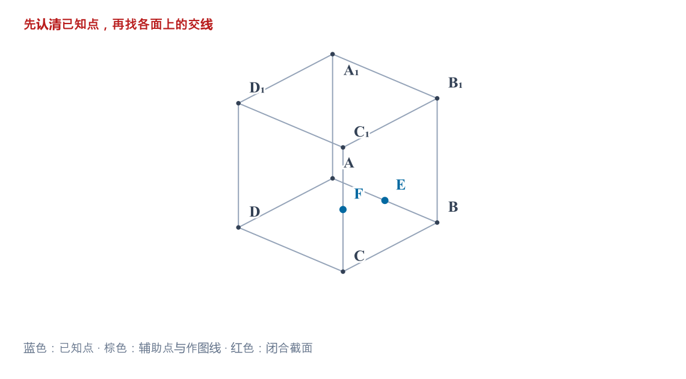
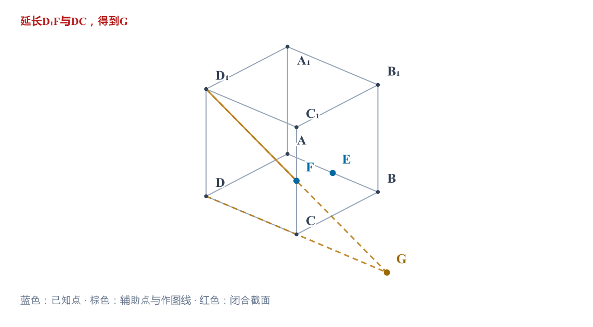
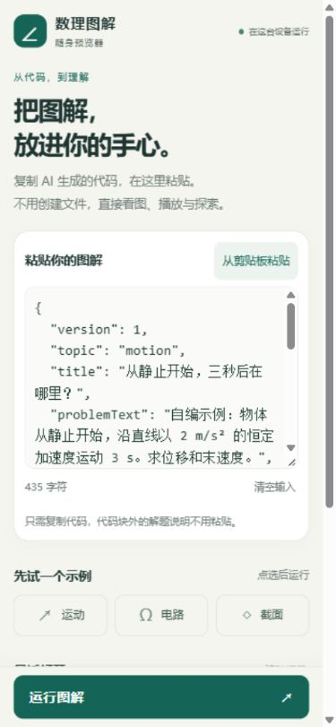

# mp_skills

面向高中数学、物理的 Agent skill 与聊天网页版提示词。

## solver-lab

[Agent skill 入口](solver-lab/SKILL.md) · [完整操作与安装说明](solver-lab/references/agent-workflow.md) · [网页版提示词](solver-lab/prompts/README.md)

Agent 负责读题、选择模型和组织讲解，内置确定性内核负责受支持的计算与数值检查。目前提供 9 类固定任务，以及匀变速运动、理想串联电路、标准截面 3 类交互课件。数值核验不等于自动证明；题意、模型条件与文字推理仍需核对。

### 截面逐步作图演示

在棱长为1的正方体 ABCD–A₁B₁C₁D₁ 中，E、F 分别为 AB、CC₁ 的中点，作经过 D₁、E、F 的截面。

图中标出顶点与辅助点。讲解从“为什么先找 G”展开：延长 D₁F 与 DC 相交于 G，连接 GE 找到 M、H，再用 D₁H 找到 N，最后闭合为五边形 D₁NEMF。点击步骤、播放或拖动进度，辅助点和交线会依次出现。



<details>
<summary>查看中间作图阶段</summary>

先识别题设给出的点，核对 E、F 所在的棱。



D₁、F 同在侧面 DCC₁D₁ 内。延长 D₁F 与 DC 找到 G，便能利用底面内的 E、G 确定截线 GE。



</details>

[下载完整单文件演示](docs/demos/section-construction.html)后用浏览器打开，或运行：

```sh
node solver-lab/scripts/agent.mjs solver-lab/lesson/examples/section-construction.json --out ./section-result --html
```

输出目录需为新目录。图片来自课件实际生成的 SVG 渲染；示例已通过步骤联动和几何检查，并获得用户本地预览反馈。各家聊天平台内的兼容性仍需分别实测。当前逐步作图支持长方体/正方体，详细字段见[作图规格](solver-lab/references/lessons.md#带点名的逐步作图)。

### 综合题与图解查看

分阶段力学、临界条件、解析几何范围/定值和三维约束题，按[综合题与证明核验](solver-lab/references/advanced-problems.md)独立推导，再用固定内核核验其支持的子关系。阶段切换、完整证明和题意对应分别说明证据；几个公式通过不等于整题自动认证。

图解优先保留原题点名、方向、单位和辅助关系。自定义报告可使用包内[SVG图解查看器](solver-lab/references/graphical-explanations.md)，支持缩放、拖动、复位、键盘和双指手势；放大查看、构造步进、时间动画与参数联动是不同能力，分别验收。

查看器资源已随skill打包。基础求解仍只需Node.js；可选的图解嵌入器在生成阶段使用Python 3标准库，生成的单文件HTML不需要Python、Node或网络。它不会自动给三个固定LessonSpec模板增加缩放功能。

### 动态图解与公式显示

静态关系、构造步进、物理时间播放与几何参数演示按教学需要选择。需要暂停、时间轴、关键事件和同步读数时，按[模型驱动的交互演示](solver-lab/references/model-driven-animation.md)制作独立HTML/SVG；简单SVG场景仍可用SMIL。此工作流不新增CLI电磁场题型，也不改三个固定模板。

图、向量、读数和阶段说明取自同一状态；跨界、零速、受力和终点分别核验。根号、分数与上下标避免隐含的宿主字体依赖，SVG可使用字形轮廓，正文保留公式。已有独立图解可用[短续接提示词](solver-lab/prompts/README.md)补动态展示，无需重复输出整套提示词或逐帧请求模型。

### 可选图解评审（默认关闭）

用户明确开启后，才额外评估是否需要绘图、怎样画、实际成图是否直观。默认关闭不逐题询问、不额外评分，也不取消正常绘图和正确性检查；开启后默认三行简评，必要时一轮针对性修正，不主动另开模型、子代理或评审服务。没有查看实际图时保留“未视觉核验”。

Agent可直接说`图解评审：开启`（默认仅本题），或明确说`本会话开启图解评审`沿用；本题设置优先，会话设置可明确关闭。这是对话约定，不是新增CLI参数、LessonSpec字段或课件按钮。标准见[可选图解评审](solver-lab/references/visual-review.md)。网页端首次开启时额外粘贴[评审附加提示词](solver-lab/prompts/web-visual-review.md)全文；不用时无需附上。

### 按题查找数学与力学方法

技能新增数学58讲、力学15专题的方法卡，包含适用前提、解题步骤、反例、变式检查和源书PDF页码。先按关键词查找，再按返回ID读取完整卡：

```sh
node solver-lab/scripts/study.mjs --query "物块和皮带共速后摩擦力" --subject physics
node solver-lab/scripts/study.mjs --id physics-05
node solver-lab/scripts/study.mjs --id math-30
node solver-lab/scripts/study.mjs --list --subject math
```

这是确定性的离线词面检索，不需要API、网络、Python或原书PDF。匹配结果只提供方法参考；卡片条件必须与原题核对，不等于新增73种原生求解器。未命中可换成模型名、物理量或数学关系词，也可列目录。详见[方法调用指南](solver-lab/references/study-guide.md)。

[仓库目录导航](docs/README.md)区分可安装技能、演示、开发测试和验证记录。资料原文、逐页全文、临时安装副本、凭证和本地归档不属于发布内容。

### 在 Agent 中使用

需要 Node.js 18+，实际验证版本为 22.22.2；运行包无需 npm install、网络或 API Key。

下载或克隆仓库后，复制**整个** `solver-lab` 文件夹到 Agent 支持的 skill 目录。例如项目级 Codex 使用 `.agents/skills/solver-lab/`，Claude Code 使用 `.claude/skills/solver-lab/`；其他宿主按其实际配置安装。请保留脚本、内核、模板和参考文件，不能只复制 `SKILL.md`。

也可先在本仓库根目录验证和试用：

```sh
node solver-lab/scripts/agent.mjs --doctor
node solver-lab/scripts/agent.mjs --capabilities
node solver-lab/scripts/agent.mjs solver-lab/lesson/examples/motion.json --out ./motion-result --html
```

输出目录必须尚不存在。成功后查看 `motion-result/solution.md`、`report.json` 和 `lesson.html`；后续试用换一个新输出目录。安装后可在支持相应调用方式的宿主中输入 `$solver-lab` 或 `/solver-lab`。

### 在聊天网页版中使用

先看[提示词导航](solver-lab/prompts/README.md)，选择**一个主入口＋按需题型补充＋当前平台补充＋本题材料**。新增七类[题型补充词](solver-lab/prompts/subjects/)：函数/数列、几何、概率统计、力学、电路/场、光学、热学；只复制相关文件中的text代码块，不把全部规则一次粘贴。

**复杂题或没有适用模板：**直接复制[复杂题图解提示词](solver-lab/prompts/web-advanced.md)，附题目和下列对应平台补充词即可。生成的图解以SVG、步骤对应和可操作的缩放/拖动为重点，明确标注独立探索与实际核验范围。无需为了使用提示词先上传三个不适用模板。

**完整适用三个固定模型的题：**

1. 选一份完整 HTML 模板：[运动](solver-lab/examples/lesson-motion.html)、[串联电路](solver-lab/examples/lesson-circuit.html)、[标准截面](solver-lab/examples/lesson-section.html)。在 GitHub 文件页通过下载按钮或 Raw 保存原文件，再附到聊天中。
2. 使用[通用提示词](solver-lab/prompts/web-common.md)，再附上 [ChatGPT](solver-lab/prompts/chatgpt.md)、[DeepSeek](solver-lab/prompts/deepseek.md)、[豆包](solver-lab/prompts/doubao.md) 或 [Qwen/千问](solver-lab/prompts/qwen.md) 对应提示词及原题。
3. 优先复用模板，只让模型生成题目 JSON，粘贴到课件输入框并“载入并核验”。播放、暂停和拖动均在本地计算，不消耗模型调用。

可先用[预览探针](solver-lab/examples/preview-probe.html)检查当前聊天页面能否执行脚本。各平台账号内预览尚待实测，文件生成或探针通过不能替代正式课件验收；详见[兼容状态与人工验收](solver-lab/docs/browser-compatibility.md)。GitHub 文件页本身不执行 HTML。

已生成页面有文字堆叠/裁切时，附现有HTML与截图，使用[布局修复续接词](solver-lab/prompts/web-layout-repair.md)。新题、仅改参数和修布局各有独立规则；普通新题不继承旧条件。修复词不再写死传送带或匀减速；明确修固定模板布局时保留原版，另存标注衍生版并重新核验。

### 手机端直接打开交互图解

[公开预览器](https://solver-lab-mobile-20261106-8082.wwk58317.chatgpt.site)支持学生复制完整HTML或受支持的LessonSpec JSON，粘贴后点击运行，无需新建文件、登录或提供模型API密钥。[手机交付提示词与步骤](solver-lab/prompts/mobile-preview.md)说明怎样让模型输出可直接运行的内容。

手机端提供底部运行按钮、16px代码输入、可视高度与安全区适配、横屏紧凑工具栏。课件在隔离iframe内运行，代码不主动上传；草稿与最近三条记录仅保存在当前浏览器。外部CDN、联网脚本等不支持，原课件的数学与排版仍需核对。

[网站源码及开发方法](mobile-preview/README.md)位于独立目录，学生使用网站无需安装它；Agent仍只安装完整的`solver-lab/`。本地18项自动测试与窄视口浏览器检查通过，安卓/iPhone实机及学生网络可达性仍未验证。详见[本次发布验证](docs/validation/2026-11-07-mobile-preview.md)。



### 发布内容与验证范围

此仓库存放可直接使用的运行包与提示词，包含 `agent-manifest.json` 文件清单。`--doctor` 检查列出文件的完整性和内核加载，不是数字签名，也不认证题意或平台预览。

此前功能版本在开发环境通过215项skill测试与10项图解DOM交互测试，并在仓库外验证了基础求解和可选图解嵌入器。2026-11-02文档修订只更新指令与文档，通过skill格式、本地引用、安装包完整性与包内运动示例检查；另做了三个场景的只读使用评估，不作为实际课件或平台运行测试。真实浏览器布局、手机实机触控和各平台账号内预览仍需分别实测。

2026-11-03新增可选图解评审，同样仅修改指令与文档；skill格式、本地引用及安装包完整性检查通过，并完成五种开关/视觉限制场景的只读使用评估。这不等同于实际课件生成或平台实测，也未重跑全部求解测试。

`solver-lab/docs/` 中的验证记录描述开发时的检查；其中源码构建、npm 测试和临时证据路径属于开发仓库环境，本运行包不包含相应开发工具。安装和使用以本页及 Agent 工作流为准。

2026-11-03资料学习增强版：开发仓库244项技能测试、10项查看器DOM测试通过；本仓库新增29项可独立运行的检索/方法卡测试。另有15个具体算例复核，覆盖首项例外、分段跨界、停车筛根、静摩擦、离板先后和参数退化；这些结果不代表对所有未见题目的整题认证。便携包内容、哈希与原有运动/截面入口已重新检查。详见[本次验证记录](docs/validation/2026-11-03-study.md)。

2026-11-05提示词整理版：16份提示词文件，补全截面边数/半径/作图契约，明确反求、停车分段与并联模型边界。开发阶段17个独立正向试答的路线与关键结论复核一致；11项编译器检查及244项既有技能回归通过。这不是各网页平台的账号实测或跨模型成功率，详见[提示词发布验证](docs/validation/2026-11-05-prompts.md)。
